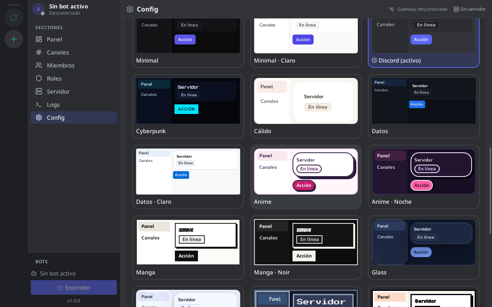
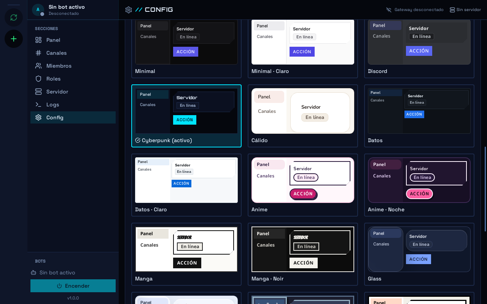

<div align="center">


# ARGUS

**Panel de escritorio para controlar tus bots de Discord… y dejar que una IA los maneje contigo**

Registra tus bots, elige con cuál trabajar y gestiona los servidores donde está:
canales, roles, permisos, miembros y moderación, con el servidor actualizado en
vivo. Con su servidor MCP, un asistente de IA como Claude Code puede hacer lo
mismo que tú desde la app.

[](https://github.com/BenReynor/ARGUS/actions/workflows/ci.yml)
· Linux · Windows (experimental) · Tauri 2 + React + Rust

[English](README.md) · **Español**

</div>

> [!NOTE]
> ARGUS trabaja con **bots propios** mediante la API oficial de Discord (token de
> bot). No es un selfbot: automatizar cuentas de usuario viola los Términos de
> Servicio de Discord.

## Capturas

| Ajustes → Apariencia (tema Discord) | El mismo panel con el tema Cyberpunk |
|---|---|
|  |  |

## Qué puedes hacer

- **Asistente IA (la función principal):** escribe el plan de tu servidor en
  Markdown (categorías, canales con descripción, roles con permisos, permisos de
  cada canal) y habla con un agente de IA (`claude`, `codex` u `opencode`, incluidos
  modelos gratis). En modo Execute propone los cambios, tú los revisas y pulsas
  **Apply**, y ARGUS construye el servidor entero en orden. El agente solo puede
  leer; ten en cuenta que tu plan y lo que lea del servidor van al proveedor del
  modelo. Ver [docs/ASISTENTE.md](docs/ASISTENTE.md) (en inglés). El plan
  también admite una sintaxis estructurada que ARGUS construye sin IA: ver
  [docs/PLAN_SERVIDOR.es.md](docs/PLAN_SERVIDOR.es.md) (en
  [inglés](docs/PLAN_SERVIDOR.md)).
- **Moderación con IA:** en la pestaña **Moderation** pide con tus palabras
  expulsar, silenciar o avisar a miembros, buscar quién dijo una palabra o
  analizar una conversación («lee #juicio y dime quién es culpable», con las
  pruebas citadas). ARGUS guarda los avisos y se los manda al usuario por DM con
  su recuento. Tú eliges cuántos mensajes se leen por canal y nada se aplica
  hasta que lo apruebas. Ver [docs/ASISTENTE.md](docs/ASISTENTE.md) (en inglés).
- **Conversar en Discord con personalidad:** por servidor, activa las respuestas,
  elige agente y modelo (un modelo gratis de opencode basta para conversar) y
  escribe la personalidad del bot. Solo responde cuando lo mencionan o le
  responden, y solo con ARGUS abierto; los mensajes que contesta van al proveedor
  del modelo. Ver
  [docs/ASISTENTE.md](docs/ASISTENTE.md#talking-on-discord-replies-from-the-bot) (en inglés).
- **Órdenes desde Discord:** elige a quién responde el bot (**Reply only to**) y
  qué miembros pueden pedirle, en un mensaje, que cambie el servidor (**Orders
  from Discord**). El modelo que conversa sigue sin herramientas: un constructor
  prepara una propuesta y ARGUS la aplica, por defecto tras confirmar el autor con
  «sí». Ver [docs/ASISTENTE.md](docs/ASISTENTE.md#orders-from-discord) (en inglés).
- **Varios bots en una app:** añade tus bots con su token; ARGUS lee de Discord su
  nombre y avatar oficiales. Cambia de bot en la barra lateral y de servidor en la
  columna de la izquierda.
- **Control total del servidor** (todo lo que permitan los permisos del bot):
  - canales y categorías: crear, editar, mover y borrar;
  - roles: crear, editar, permisos y jerarquía;
  - permisos de cada canal (overwrites);
  - miembros: roles, timeout, expulsar y banear;
  - ajustes del servidor y registro de auditoría;
  - mensajes, DMs, invitaciones y webhooks.

  Las acciones destructivas piden confirmación, y lo que el bot no puede hacer
  aparece desactivado con el motivo.
- **Servidor en vivo:** ARGUS se conecta al Gateway de Discord; lo que cambia en
  Discord (canales, roles, miembros que entran o salen) aparece al instante, sin
  recargar, y queda un historial en **Logs**.
- **Ajustes propios por servidor**, que se conservan al cambiar de uno a otro.
- **Conecta una IA (MCP):** el binario `argus-mcp` ofrece 47 herramientas para que
  Claude Code u otro cliente MCP gestione Discord con tus bots, incluso con ARGUS
  cerrado.
- **10 temas:** Discord (por defecto), minimal, cyberpunk, cálido, datos, anime,
  manga, glass, retro y brutalista, con modo claro u oscuro donde lo hay.
- **Inglés y español:** la interfaz, los mensajes de error y el MCP están en
  inglés por defecto; cambia el idioma en Ajustes.

## Instalación

| Sistema | Estado |
|---|---|
| **Linux** | ✅ Se desarrolla y se usa aquí. |
| **Windows** | 🧪 Experimental, no está al 100 %: los tests pasan y el instalador se genera en el CI, pero aún no se ha probado en un PC real. |
| **Agentes de IA** | ✅ `claude` probado en un servidor real. 🧪 `codex` y OpenCode v2 tienen integración y pruebas automáticas; falta la validación en un servidor real. Los modelos gratis dependen del proveedor de OpenCode. |

### Descargar

Baja la última versión de **[Releases](https://github.com/BenReynor/ARGUS/releases/latest)**:

| Sistema | Archivo |
|---|---|
| **Windows** | `ARGUS_x.y.z_x64-setup.exe` (instalador) o `ARGUS_x.y.z_x64_en-US.msi` |
| **Linux** (Debian, Ubuntu, Mint…) | `ARGUS_x.y.z_amd64.deb`: `sudo apt install ./ARGUS_*.deb` |
| **Linux** (cualquier distro) | `ARGUS_x.y.z_amd64.AppImage`: `chmod +x ARGUS_*.AppImage` y ábrelo |

Todos incluyen `argus-mcp`. En Windows, como el instalador no está firmado,
aparece «Windows protegió tu PC»: **Más información → Ejecutar de todas formas**.
ARGUS usa WebView2, que ya viene con Windows 10 y 11. La suma SHA-256 de cada
archivo está en `SHA256SUMS`. Si algo falla,
[abre un issue](https://github.com/BenReynor/ARGUS/issues).

### Linux (desde el código)

Necesitas **Rust** estable, **Node** 22+ y las librerías de WebKitGTK. En
Debian/Ubuntu:

```bash
sudo apt install libgtk-3-dev libwebkit2gtk-4.1-dev libayatana-appindicator3-dev librsvg2-dev
git clone https://github.com/BenReynor/ARGUS.git
cd ARGUS
npm install
npm run tauri build -- --config src-tauri/tauri.unsigned.conf.json
```

Los paquetes quedan en `src-tauri/target/release/bundle/` (`.deb`, `.rpm` y
`.AppImage`) e incluyen `argus-mcp`.

**Alternativa que se actualiza sola:** `scripts/abrir-argus.sh` compila ARGUS
desde la última versión de `main` (solo si cambió, con una ventana de progreso) y
lo abre. Ponlo como comando de un acceso directo:

```ini
[Desktop Entry]
Type=Application
Name=ARGUS
Exec=/ruta/a/ARGUS/scripts/abrir-argus.sh
Icon=argus
```

Tras cada compilación instala el icono `argus` en tu tema de iconos. El binario y
el log de compilación están en `~/.local/share/argus-app/`.

Para probar cambios locales ya compilados: `npm run tauri build -- --no-bundle`
y luego `scripts/abrir-argus.sh --local`. Este modo abre los binarios release
de esta copia sin sustituirlos por la versión de `main`.

## Primeros pasos

1. **Crea tu bot** en el [Developer Portal de Discord](https://discord.com/developers/applications):
   *New Application* → **Bot** → *Reset Token* y copia el token. En esa misma
   página activa **Server Members Intent** (Privileged Gateway Intents), para
   que ARGUS pueda leer los miembros.
2. En ARGUS, ve a **Config → Bots**, pega el token y pulsa **Añadir bot**. ARGUS
   lo valida con Discord y muestra su nombre y avatar.
3. Pulsa **Invitar a un servidor**: se abre la invitación de Discord con los
   permisos básicos (ver canales, mensajes, gestionar canales y roles, timeout,
   expulsar y banear). Mantén el bot **sin Administrador** y concede solo los
   permisos necesarios. Sube su rol solo por encima de los roles que deba gestionar.
4. Pulsa **Encender** para conectarlo y elige el servidor en la columna de la
   izquierda. **Panel**, **Canales**, **Miembros**, **Roles**, **Servidor** y
   **Logs** trabajan sobre ese servidor.

## Conectar un asistente de IA (MCP)

En **Config → MCP** tienes la ruta de `argus-mcp` y los bloques listos para
copiar. Con Claude Code:

```bash
claude mcp add argus -- /ruta/a/argus-mcp
```

Para Codex, usa `codex mcp add argus -- /ruta/a/argus-mcp`. Para OpenCode,
Ajustes → MCP ofrece el bloque específico de `opencode.json`.

> [!WARNING]
> El MCP puede hacer **todo lo que permitan los permisos del bot**, incluido
> borrar canales o banear miembros. Conéctalo solo a clientes de confianza y
> pruébalo primero en un servidor de pruebas.

Lista de herramientas, otros clientes y solución de problemas:
[`docs/MCP.md`](docs/MCP.md).

## Privacidad y seguridad

Consulta la [guía de seguridad](docs/SEGURIDAD.md): protecciones, riesgos que
quedan, configuración recomendada y cómo reportar una vulnerabilidad en privado.

- Los tokens se guardan **cifrados** (AES-256-GCM) en una base de datos local
  (`~/.config/argus/` en Linux, `%APPDATA%\argus\` en Windows). Nunca en texto
  plano, en el almacenamiento del navegador ni en los logs.
- La clave maestra aleatoria de 32 bytes se guarda en el llavero del sistema:
  Secret Service en Linux, Credential Manager en Windows (Keychain en macOS).
  La app y `argus-mcp` comparten la entrada `argus` / `master-key-v2`. Los tokens
  antiguos cifrados con la clave del machine-id se migran automáticamente en
  una transacción, sin perder bots. Los ya migrados no se vuelven a cifrar.
- Si el llavero no está disponible, ARGUS conserva el cifrado antiguo para
  nuevos tokens y avisa en Ajustes. Habilita/desbloquea el llavero y reinicia
  para migrar. Los tokens ya migrados permanecen intactos y necesitan el
  llavero original; copiar solo la BD no permite recuperar su acceso.
- ARGUS no tiene telemetría. Las funciones de IA envían contexto, incluidos los
  datos que lee el agente, al proveedor del modelo elegido. Revisa qué compartes.
- Nada está atado a un servidor, canal o bot concreto; sirve para cualquiera.

## Estado y lo que viene

Hecho y probado en un servidor real: varios bots, servidor en vivo, control
total del servidor, el MCP, el asistente IA (construcción y moderación), el plan
estructurado, la personalidad del bot en Discord y las órdenes desde Discord (con
`claude`).

Sin probar del todo: Windows en un PC real (experimental) y los agentes `codex` / `opencode`.

Lo siguiente (sin fecha): plantillas para copiar la estructura de un servidor a
otro, vigilancia con alertas, notificaciones y copias de seguridad. Los
detalles están en [`CONTEXTO.md`](CONTEXTO.md) y [`plan.md`](plan.md).

## Desarrollo

```bash
npm install
npm run tauri dev        # app con recarga en caliente

# comprobaciones (las mismas que el CI)
cargo fmt   --manifest-path src-tauri/Cargo.toml --check
cargo check --manifest-path src-tauri/Cargo.toml
cargo test  --manifest-path src-tauri/Cargo.toml
npm run build            # tsc + vite build
```

Los tests no usan la red ni tokens: el cliente de Discord apunta a un Discord
falso local. Hay tests opcionales contra un servidor real en
[`docs/PRUEBA_REAL.md`](docs/PRUEBA_REAL.md). El CI corre todo en Linux y
Windows y genera el instalador de Windows.

Dependabot comprueba semanalmente las dependencias de Cargo (`src-tauri/`), npm
(raíz del repositorio) y GitHub Actions, agrupando las actualizaciones por
ecosistema con un límite de 5 PR abiertas por ecosistema. Las PR de Dependabot
deben pasar el mismo CI que las demás antes de fusionarse: compilación del
frontend y tests de Rust en Linux y Windows, además del instalador de Windows.

El proyecto se desarrolla con [Dédalo](https://github.com/BenReynor/dedalo):
`plan.md` usa su formato y cada tarea pasa el mismo gate. Más documentación:

- [`CONTEXTO.md`](CONTEXTO.md): visión y decisiones
- [`ARCHITECTURE_MAP.md`](ARCHITECTURE_MAP.md): qué hay en cada archivo
- [`docs/FICHA_TECNICA.md`](docs/FICHA_TECNICA.md): stack, datos y comandos
- [`AGENTS.md`](AGENTS.md): reglas para agentes de IA que trabajen en el código

## Contribuir

Las contribuciones son bienvenidas: abre un
[issue](https://github.com/BenReynor/ARGUS/issues) para contar un fallo o
proponer una idea, o un pull request con el cambio. Antes de enviarlo, pasa las
comprobaciones de [Desarrollo](#desarrollo) (el CI las corre en Linux y Windows)
y, si tocas algo de Discord, añade un test contra el Discord falso. La interfaz y
los mensajes van en inglés por defecto, con traducción al español (`t()` y
catálogo).

## Licencia

[MIT](LICENSE): puedes usar, copiar, modificar y distribuir ARGUS libremente,
también en proyectos propios, manteniendo el aviso de copyright.
