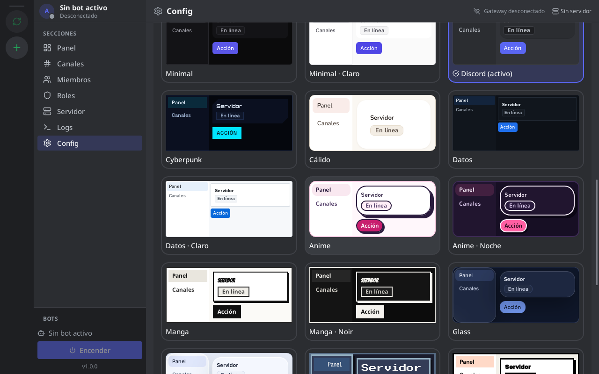
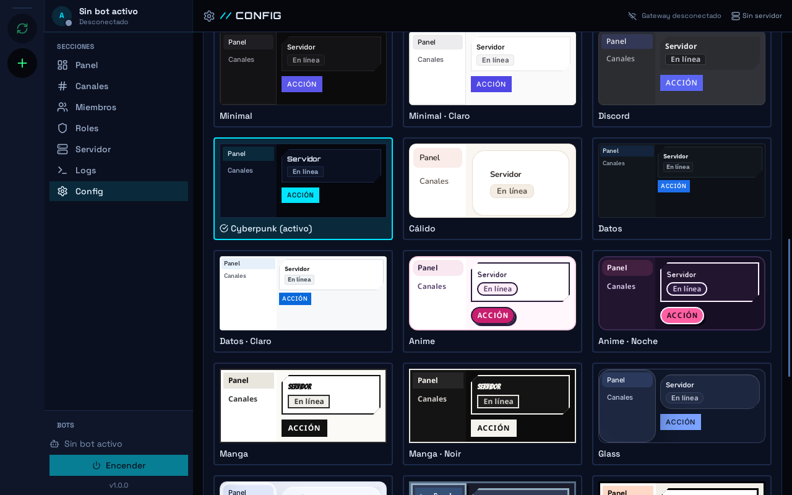

<div align="center">


# ARGUS

**Panel de escritorio para controlar tus bots de Discord… y dejar que una IA los maneje contigo**

Registra tus bots, elige con cuál trabajar y gestiona los servidores donde está:
canales, roles, permisos, miembros y moderación, con el servidor actualizado en
vivo. Con su servidor MCP, un asistente de IA como Claude Code puede hacer lo
mismo que tú desde la app.

[](https://github.com/BenReynor/ARGUS/actions/workflows/ci.yml)
· Linux · Windows (experimental) · Tauri 2 + React + Rust

[English](README.md) · **Español**

</div>

> [!NOTE]
> ARGUS trabaja con **bots propios** mediante la API oficial de Discord (token de
> bot). No es un selfbot: automatizar cuentas de usuario viola los Términos de
> Servicio de Discord.

## Capturas

| Ajustes → Apariencia (tema Discord) | El mismo panel con el tema Cyberpunk |
|---|---|
|  |  |

## Qué puedes hacer

- **Asistente IA (la función principal):** escribe el plan de tu servidor en
  Markdown (categorías, canales con descripción, roles con permisos, permisos de
  cada canal) y habla con un agente de IA (`claude` u `opencode`, incluidos
  modelos gratis). En modo Execute propone los cambios, tú los revisas y pulsas
  **Apply**, y ARGUS construye el servidor entero en orden. El agente solo puede
  leer; ten en cuenta que tu plan y lo que lea del servidor van al proveedor del
  modelo. Ver [docs/ASISTENTE.md](docs/ASISTENTE.md) (en inglés).
- **Conversar en Discord con personalidad:** por servidor, activa las respuestas,
  elige agente y modelo (un modelo gratis de opencode basta para conversar) y
  escribe la personalidad del bot. Solo responde cuando lo mencionan o le
  responden, y solo con ARGUS abierto; los mensajes que contesta van al proveedor
  del modelo. Ver
  [docs/ASISTENTE.md](docs/ASISTENTE.md#talking-on-discord-replies-from-the-bot) (en inglés).
- **Varios bots en una app:** añade tus bots con su token; ARGUS lee de Discord su
  nombre y avatar oficiales. Cambia de bot en la barra lateral y de servidor en la
  columna de la izquierda.
- **Control total del servidor** (todo lo que permitan los permisos del bot):
  - canales y categorías: crear, editar, mover y borrar;
  - roles: crear, editar, permisos y jerarquía;
  - permisos de cada canal (overwrites);
  - miembros: roles, timeout, expulsar y banear;
  - ajustes del servidor y registro de auditoría;
  - mensajes, DMs, invitaciones y webhooks.

  Las acciones destructivas piden confirmación, y lo que el bot no puede hacer
  aparece desactivado con el motivo.
- **Servidor en vivo:** ARGUS se conecta al Gateway de Discord; lo que cambia en
  Discord (canales, roles, miembros que entran o salen) aparece al instante, sin
  recargar, y queda un historial en **Logs**.
- **Ajustes propios por servidor**, que se conservan al cambiar de uno a otro.
- **Conecta una IA (MCP):** el binario `argus-mcp` ofrece 44 herramientas para que
  Claude Code u otro cliente MCP gestione Discord con tus bots, incluso con ARGUS
  cerrado.
- **10 temas:** Discord (por defecto), minimal, cyberpunk, cálido, datos, anime,
  manga, glass, retro y brutalista, con modo claro u oscuro donde lo hay.
- **Inglés y español:** la interfaz, los mensajes de error y el MCP están en
  inglés por defecto; cambia el idioma en Ajustes.

## Instalación

| Sistema | Estado |
|---|---|
| **Linux** | ✅ Se desarrolla y se usa aquí. |
| **Windows** | 🧪 Experimental: los tests pasan y el instalador se genera en el CI, pero aún no se ha probado en un PC real. |

### Descargar

Baja la última versión de **[Releases](https://github.com/BenReynor/ARGUS/releases/latest)**:

| Sistema | Archivo |
|---|---|
| **Windows** | `ARGUS_x.y.z_x64-setup.exe` (instalador) o `ARGUS_x.y.z_x64_en-US.msi` |
| **Linux** (Debian, Ubuntu, Mint…) | `ARGUS_x.y.z_amd64.deb`: `sudo apt install ./ARGUS_*.deb` |
| **Linux** (cualquier distro) | `ARGUS_x.y.z_amd64.AppImage`: `chmod +x ARGUS_*.AppImage` y ábrelo |

Todos incluyen `argus-mcp`. En Windows, como el instalador no está firmado,
aparece «Windows protegió tu PC»: **Más información → Ejecutar de todas formas**.
ARGUS usa WebView2, que ya viene con Windows 10 y 11. La suma SHA-256 de cada
archivo está en `SHA256SUMS`. Si algo falla,
[abre un issue](https://github.com/BenReynor/ARGUS/issues).

### Linux (desde el código)

Necesitas **Rust** estable, **Node** 22+ y las librerías de WebKitGTK. En
Debian/Ubuntu:

```bash
sudo apt install libgtk-3-dev libwebkit2gtk-4.1-dev libayatana-appindicator3-dev librsvg2-dev
git clone https://github.com/BenReynor/ARGUS.git
cd ARGUS
npm install
npm run tauri build
```

Los paquetes quedan en `src-tauri/target/release/bundle/` (`.deb`, `.rpm` y
`.AppImage`) e incluyen `argus-mcp`.

**Alternativa que se actualiza sola:** `scripts/abrir-argus.sh` compila ARGUS
desde la última versión de `main` (solo si cambió, con una ventana de progreso) y
lo abre. Ponlo como comando de un acceso directo:

```ini
[Desktop Entry]
Type=Application
Name=ARGUS
Exec=/ruta/a/ARGUS/scripts/abrir-argus.sh
Icon=argus
```

Tras cada compilación instala el icono `argus` en tu tema de iconos. El binario y
el log de compilación están en `~/.local/share/argus-app/`.

## Primeros pasos

1. **Crea tu bot** en el [Developer Portal de Discord](https://discord.com/developers/applications):
   *New Application* → **Bot** → *Reset Token* y copia el token. En esa misma
   página activa **Server Members Intent** (Privileged Gateway Intents), para
   que ARGUS pueda leer los miembros.
2. En ARGUS, ve a **Config → Bots**, pega el token y pulsa **Añadir bot**. ARGUS
   lo valida con Discord y muestra su nombre y avatar.
3. Pulsa **Invitar a un servidor**: se abre la invitación de Discord con los
   permisos básicos (ver canales, mensajes, gestionar canales y roles, timeout,
   expulsar y banear). Para el **control total**, dale después al bot un rol con
   **Administrador** y súbelo en la jerarquía por encima de los roles que deba
   gestionar.
4. Pulsa **Encender** para conectarlo y elige el servidor en la columna de la
   izquierda. **Panel**, **Canales**, **Miembros**, **Roles**, **Servidor** y
   **Logs** trabajan sobre ese servidor.

## Conectar un asistente de IA (MCP)

En **Config → MCP** tienes la ruta de `argus-mcp` y los bloques listos para
copiar. Con Claude Code:

```bash
claude mcp add argus -- /ruta/a/argus-mcp
```

> [!WARNING]
> El MCP puede hacer **todo lo que permitan los permisos del bot**, incluido
> borrar canales o banear miembros. Conéctalo solo a clientes de confianza y
> pruébalo primero en un servidor de pruebas.

Lista de herramientas, otros clientes y solución de problemas:
[`docs/MCP.md`](docs/MCP.md).

## Privacidad y seguridad

- Los tokens se guardan **cifrados** (AES-256-GCM) en una base de datos local
  (`~/.config/argus/` en Linux, `%APPDATA%\argus\` en Windows). Nunca en texto
  plano, en el almacenamiento del navegador ni en los logs.
- ARGUS no tiene telemetría: solo habla con la API de Discord.
- Nada está atado a un servidor, canal o bot concreto; sirve para cualquiera.

## Estado y lo que viene

Hecho: varios bots, datos y acciones reales, servidor en vivo, interfaz con
temas, control total del servidor y el MCP. Falta la prueba manual final en un
servidor real y probar Windows en un PC.

Lo siguiente (sin fecha): plantillas para copiar la estructura de un servidor a
otro, **personalidad del bot** (respuestas con un modelo de lenguaje
configurable), vigilancia con alertas, notificaciones y copias de seguridad. Los
detalles están en [`CONTEXTO.md`](CONTEXTO.md) y [`plan.md`](plan.md).

## Desarrollo

```bash
npm install
npm run tauri dev        # app con recarga en caliente

# comprobaciones (las mismas que el CI)
cargo fmt   --manifest-path src-tauri/Cargo.toml --check
cargo check --manifest-path src-tauri/Cargo.toml
cargo test  --manifest-path src-tauri/Cargo.toml
npm run build            # tsc + vite build
```

Los tests no usan la red ni tokens: el cliente de Discord apunta a un Discord
falso local. Hay tests opcionales contra un servidor real en
[`docs/PRUEBA_REAL.md`](docs/PRUEBA_REAL.md). El CI corre todo en Linux y
Windows y genera el instalador de Windows.

El proyecto se desarrolla con [Dédalo](https://github.com/BenReynor/dedalo):
`plan.md` usa su formato y cada tarea pasa el mismo gate. Más documentación:

- [`CONTEXTO.md`](CONTEXTO.md): visión y decisiones
- [`ARCHITECTURE_MAP.md`](ARCHITECTURE_MAP.md): qué hay en cada archivo
- [`docs/FICHA_TECNICA.md`](docs/FICHA_TECNICA.md): stack, datos y comandos
- [`AGENTS.md`](AGENTS.md): reglas para agentes de IA que trabajen en el código

## Contribuir

Las contribuciones son bienvenidas: abre un
[issue](https://github.com/BenReynor/ARGUS/issues) para contar un fallo o
proponer una idea, o un pull request con el cambio. Antes de enviarlo, pasa las
comprobaciones de [Desarrollo](#desarrollo) (el CI las corre en Linux y Windows)
y, si tocas algo de Discord, añade un test contra el Discord falso. La interfaz y
los mensajes van en inglés por defecto, con traducción al español (`t()` y
catálogo).

## Licencia

[MIT](LICENSE): puedes usar, copiar, modificar y distribuir ARGUS libremente,
también en proyectos propios, manteniendo el aviso de copyright.
