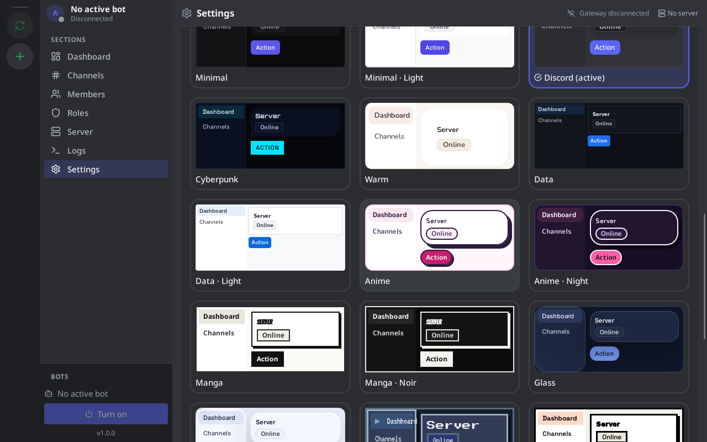
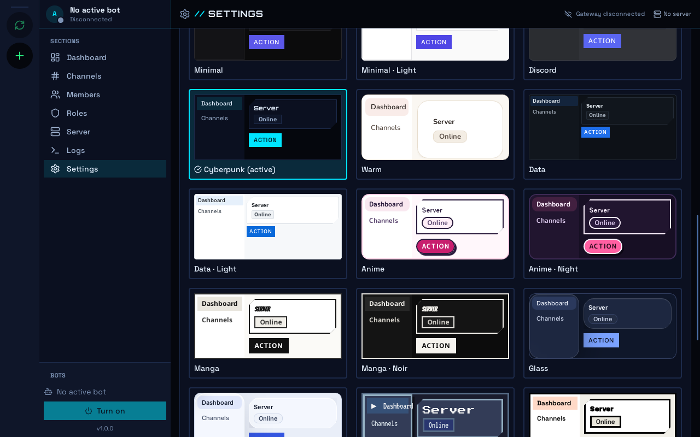

<div align="center">


# ARGUS

**A desktop panel to control your Discord bots… and let an AI run them with you**

Register your bots, pick which one to work with and manage the servers it is in:
channels, roles, permissions, members and moderation, with the server updated
live. With its MCP server, an AI assistant such as Claude Code can do the same
things you do from the app.

[](https://github.com/BenReynor/ARGUS/actions/workflows/ci.yml)
· Linux · Windows (experimental) · Tauri 2 + React + Rust

**English** · [Español](README.es.md)

</div>

> [!NOTE]
> ARGUS works with **your own bots** through the official Discord API (bot
> token). It is not a selfbot: automating user accounts violates Discord's Terms
> of Service.

## Screenshots

| Settings → Appearance (Discord theme) | The same panel with the Cyberpunk theme |
|---|---|
|  |  |

## What you can do

- **AI Assistant (the main feature):** write your server plan in Markdown
  (categories, channels with descriptions, roles with permissions, per-channel
  permissions) and chat with an AI agent (`claude` or `opencode`, including free
  models). In Execute mode it proposes the changes, you review them and press
  **Apply**, and ARGUS builds the whole server in order. The agent can only read;
  note that your plan and what it reads from the server go to the model's
  provider. See [docs/ASISTENTE.md](docs/ASISTENTE.md).
- **Several bots in one app:** add your bots with their token; ARGUS reads their
  official name and avatar from Discord. Switch bots in the sidebar and servers
  in the left-hand column.
- **Full server control** (everything the bot's permissions allow):
  - channels and categories: create, edit, move and delete;
  - roles: create, edit, permissions and hierarchy;
  - per-channel permissions (overwrites);
  - members: roles, timeout, kick and ban;
  - server settings and audit log;
  - messages, DMs, invites and webhooks.

  Destructive actions ask for confirmation, and whatever the bot cannot do
  appears disabled with the reason.
- **Live server:** ARGUS connects to the Discord Gateway; whatever changes in
  Discord (channels, roles, members joining or leaving) shows up instantly,
  without reloading, and a history is kept in **Logs**.
- **Per-server settings**, kept when you switch from one server to another.
- **Connect an AI (MCP):** the `argus-mcp` binary offers 44 tools so Claude Code
  or another MCP client can manage Discord with your bots, even with ARGUS
  closed.
- **10 themes:** Discord (default), minimal, cyberpunk, warm, data, anime, manga,
  glass, retro and brutalist, with light or dark mode where available.
- **English and Spanish:** the interface, error messages and the MCP are in
  English by default; change the language in Settings.

## Installation

| System | Status |
|---|---|
| **Linux** | ✅ Developed and used here. |
| **Windows** | 🧪 Experimental: tests pass and the installer is built in CI, but it has not been tried on a real PC yet. |

### Download

Get the latest version from **[Releases](https://github.com/BenReynor/ARGUS/releases/latest)**:

| System | File |
|---|---|
| **Windows** | `ARGUS_x.y.z_x64-setup.exe` (installer) or `ARGUS_x.y.z_x64_en-US.msi` |
| **Linux** (Debian, Ubuntu, Mint…) | `ARGUS_x.y.z_amd64.deb`: `sudo apt install ./ARGUS_*.deb` |
| **Linux** (any distro) | `ARGUS_x.y.z_amd64.AppImage`: `chmod +x ARGUS_*.AppImage` and open it |

All of them include `argus-mcp`. On Windows, since the installer is not signed,
you will see “Windows protected your PC”: **More info → Run anyway**. ARGUS uses
WebView2, which already ships with Windows 10 and 11. The SHA-256 sum of each
file is in `SHA256SUMS`. If something fails,
[open an issue](https://github.com/BenReynor/ARGUS/issues).

### Linux (from source)

You need stable **Rust**, **Node** 22+ and the WebKitGTK libraries. On
Debian/Ubuntu:

```bash
sudo apt install libgtk-3-dev libwebkit2gtk-4.1-dev libayatana-appindicator3-dev librsvg2-dev
git clone https://github.com/BenReynor/ARGUS.git
cd ARGUS
npm install
npm run tauri build
```

The packages end up in `src-tauri/target/release/bundle/` (`.deb`, `.rpm` and
`.AppImage`) and include `argus-mcp`.

**Self-updating alternative:** `scripts/abrir-argus.sh` builds ARGUS from the
latest version of `main` (only if it changed, with a progress window) and opens
it. Use it as the command of a launcher:

```ini
[Desktop Entry]
Type=Application
Name=ARGUS
Exec=/path/to/ARGUS/scripts/abrir-argus.sh
Icon=argus
```

After each build it installs the `argus` icon in your icon theme. The binary and
the build log are in `~/.local/share/argus-app/`.

## Getting started

1. **Create your bot** in the [Discord Developer Portal](https://discord.com/developers/applications):
   *New Application* → **Bot** → *Reset Token* and copy the token. On that same
   page enable **Server Members Intent** (Privileged Gateway Intents), so ARGUS
   can read the members.
2. In ARGUS, go to **Settings → Bots**, paste the token and click **Add bot**.
   ARGUS validates it with Discord and shows its name and avatar.
3. Click **Invite to a server**: the Discord invite opens with the basic
   permissions (view channels, messages, manage channels and roles, timeout,
   kick and ban). For **full control**, then give the bot a role with
   **Administrator** and move it above the roles it has to manage in the
   hierarchy.
4. Click **Turn on** to connect it and pick the server in the left-hand column.
   **Dashboard**, **Channels**, **Members**, **Roles**, **Server** and **Logs**
   work on that server.

## Connect an AI assistant (MCP)

In **Settings → MCP** you will find the path of `argus-mcp` and ready-to-copy
blocks. With Claude Code:

```bash
claude mcp add argus -- /path/to/argus-mcp
```

> [!WARNING]
> The MCP can do **everything the bot's permissions allow**, including deleting
> channels or banning members. Connect it only to trusted clients and try it
> first on a test server.

Tool list, other clients and troubleshooting: [`docs/MCP.md`](docs/MCP.md).

## Privacy and security

- Tokens are stored **encrypted** (AES-256-GCM) in a local database
  (`~/.config/argus/` on Linux, `%APPDATA%\argus\` on Windows). Never in plain
  text, in browser storage or in the logs.
- ARGUS has no telemetry: it only talks to the Discord API.
- Nothing is tied to a specific server, channel or bot; it works for anyone.

## Status and what's next

Done: several bots, real data and actions, live server, themed interface, full
server control and the MCP. Still missing: the final manual test on a real
server and trying Windows on a PC.

Next (no date): templates to copy a server's structure to another one, **bot
personality** (replies with a configurable language model), monitoring with
alerts, notifications and backups. Details are in [`CONTEXTO.md`](CONTEXTO.md)
and [`plan.md`](plan.md) (both in Spanish).

## Development

```bash
npm install
npm run tauri dev        # app with hot reload

# checks (the same as CI)
cargo fmt   --manifest-path src-tauri/Cargo.toml --check
cargo check --manifest-path src-tauri/Cargo.toml
cargo test  --manifest-path src-tauri/Cargo.toml
npm run build            # tsc + vite build
```

Tests use neither the network nor tokens: the Discord client points to a local
fake Discord. There are optional tests against a real server in
[`docs/PRUEBA_REAL.md`](docs/PRUEBA_REAL.md). CI runs everything on Linux and
Windows and builds the Windows installer.

The project is developed with [Dédalo](https://github.com/BenReynor/dedalo):
`plan.md` uses its format and every task passes the same gate. More
documentation (in Spanish):

- [`CONTEXTO.md`](CONTEXTO.md): vision and decisions
- [`ARCHITECTURE_MAP.md`](ARCHITECTURE_MAP.md): what each file contains
- [`docs/FICHA_TECNICA.md`](docs/FICHA_TECNICA.md): stack, data and commands
- [`AGENTS.md`](AGENTS.md): rules for AI agents working on the code

## Contributing

Contributions are welcome: open an
[issue](https://github.com/BenReynor/ARGUS/issues) to report a bug or propose an
idea, or a pull request with the change. Before sending it, run the checks in
[Development](#development) (CI runs them on Linux and Windows) and, if you touch
anything Discord-related, add a test against the fake Discord. The interface and
messages are in English by default, with the Spanish translation in the catalog
(`t()` and catalog).

## License

[MIT](LICENSE): you may use, copy, modify and distribute ARGUS freely, also in
your own projects, keeping the copyright notice.
