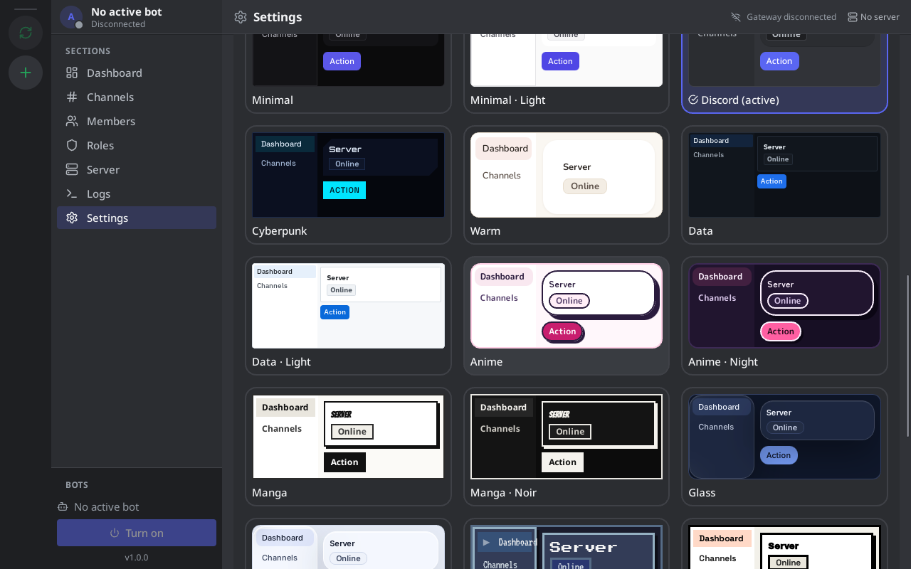
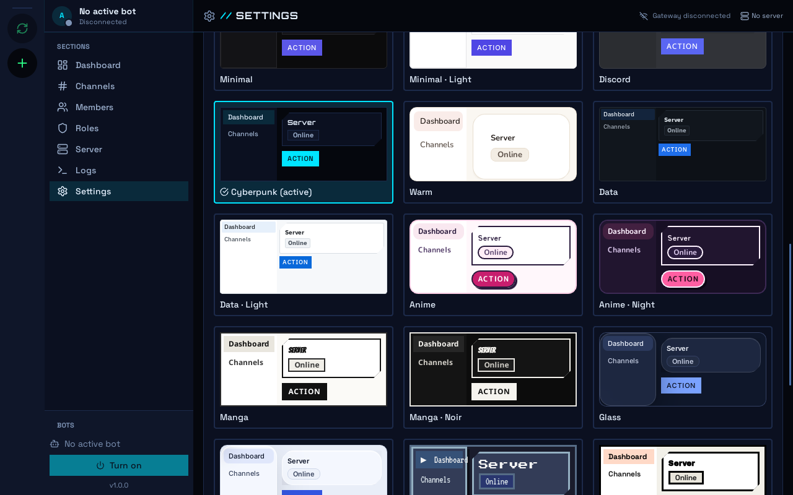

<div align="center">


# ARGUS

**A desktop panel to control your Discord bots… and let an AI run them with you**

Register your bots, pick which one to work with and manage the servers it is in:
channels, roles, permissions, members and moderation, with the server updated
live. With its MCP server, an AI assistant such as Claude Code can do the same
things you do from the app.

[](https://github.com/BenReynor/ARGUS/actions/workflows/ci.yml)
· Linux · Windows (experimental) · Tauri 2 + React + Rust

**English** · [Español](README.es.md)

</div>

> [!NOTE]
> ARGUS works with **your own bots** through the official Discord API (bot
> token). It is not a selfbot: automating user accounts violates Discord's Terms
> of Service.

## Screenshots

| Settings → Appearance (Discord theme) | The same panel with the Cyberpunk theme |
|---|---|
|  |  |

## What you can do

- **AI Assistant (the main feature):** write your server plan in Markdown
  (categories, channels with descriptions, roles with permissions, per-channel
  permissions) and chat with an AI agent (`claude`, `codex` or `opencode`, including free
  models). In Execute mode it proposes the changes, you review them and press
  **Apply**, and ARGUS builds the whole server in order. The agent can only read;
  note that your plan and what it reads from the server go to the model's
  provider. See [docs/ASISTENTE.md](docs/ASISTENTE.md). The plan also has a
  structured syntax that ARGUS builds without AI: see
  [docs/PLAN_SERVIDOR.md](docs/PLAN_SERVIDOR.md) (also in
  [Spanish](docs/PLAN_SERVIDOR.es.md)).
- **Moderation with AI:** in the **Moderation** tab, ask in plain words to kick,
  mute or warn members, search who said a word, or analyse a conversation
  ("read #trial and tell me who is guilty", with quoted evidence). Warnings are
  kept by ARGUS and sent to the user by DM with their count. You choose how many
  messages are read per channel, and nothing is applied until you approve it. See
  [docs/ASISTENTE.md](docs/ASISTENTE.md).
- **Chat on Discord with a personality:** per server, turn on replies, pick an
  agent and model (a free opencode model is enough to chat) and write the bot's
  personality. It answers only when mentioned or replied to, and only while ARGUS
  is open; the messages it answers go to the model's provider. See
  [docs/ASISTENTE.md](docs/ASISTENTE.md#talking-on-discord-replies-from-the-bot).
- **Orders from Discord:** choose who the bot answers (**Reply only to**) and
  which members can ask it, in a message, to change the server (**Orders from
  Discord**). The chatting model still has no tools: a builder prepares a
  proposal and ARGUS applies it, by default after the author confirms with "yes".
  See [docs/ASISTENTE.md](docs/ASISTENTE.md#orders-from-discord).
- **Several bots in one app:** add your bots with their token; ARGUS reads their
  official name and avatar from Discord. Switch bots in the sidebar and servers
  in the left-hand column.
- **Full server control** (everything the bot's permissions allow):
  - channels and categories: create, edit, move and delete;
  - roles: create, edit, permissions and hierarchy;
  - per-channel permissions (overwrites);
  - members: roles, timeout, kick and ban;
  - server settings and audit log;
  - messages, DMs, invites and webhooks.

  Destructive actions ask for confirmation, and whatever the bot cannot do
  appears disabled with the reason.
- **Live server:** ARGUS connects to the Discord Gateway; whatever changes in
  Discord (channels, roles, members joining or leaving) shows up instantly,
  without reloading, and a history is kept in **Logs**.
- **Per-server settings**, kept when you switch from one server to another.
- **Checked results and history (Activity):** every operation shows its steps,
  progress, failure reason and a follow-up check that reads the result back from
  Discord. A request that was only accepted, or partly done, is never shown as
  complete success. The history is kept per bot and server and the AI can read
  it. See [docs/INVENTARIO_OPERACIONES.md](docs/INVENTARIO_OPERACIONES.md).
- **Diagnostics:** checks connection, permissions, agents, MCP and storage
  without changing Discord or calling paid models, with a next step for each
  result and a report that contains no secrets.
- **Template library:** save your own plans or snapshots as templates, edit,
  search, duplicate, import and export them, and apply one to another authorized
  server with a preview and your approval. No tokens or source IDs travel with
  them. See [docs/PLANTILLAS_PORTATILES.md](docs/PLANTILLAS_PORTATILES.md).
- **Permission audit:** computes effective access, compares it with what you
  expect (your plan or a snapshot), explains each finding and prepares
  corrections that you approve and that are re-checked afterwards.
- **Connectors for other bots:** a catalogue of integrations with their real
  capabilities and limits. Connect a service with its own credential (stored
  encrypted, never shown again), let the AI read through it and prepare
  proposals that a controlled adapter applies after your approval.
- **Snapshots and restore:** local snapshots of a server, comparison, manual
  restore with a proposal you approve, and alerts for mass destruction or mass
  kicks. See [docs/SNAPSHOTS.md](docs/SNAPSHOTS.md),
  [docs/RESTAURACION.md](docs/RESTAURACION.md),
  [docs/DESTRUCCION_MASIVA.md](docs/DESTRUCCION_MASIVA.md) and
  [docs/EXPULSION_MASIVA.md](docs/EXPULSION_MASIVA.md).
- **Encrypted backups:** password-protected portable copies of the configuration,
  with preview and confirmation. See [docs/COPIAS_SEGURIDAD.md](docs/COPIAS_SEGURIDAD.md).
- **Optional background service:** off by default; runs ARGUS without a window
  with a single Gateway connection per bot. Closing the window only hides it in
  the tray; Quit ends the process. See [docs/SERVICIO.md](docs/SERVICIO.md).
- **Signed updates:** ARGUS checks for new versions and installs one only after
  you press Update, verifying its signature.
- **In-app Manual:** the **Manual** entry in the sidebar (and the **?** button of
  each view) explains every area: what it does, how to use it and its limits,
  with search. Its text lives in [`src/manual.ts`](src/manual.ts).
- **Connect an AI (MCP):** the `argus-mcp` binary offers more than 55 tools so
  Claude Code or another MCP client can manage Discord with your bots, even with
  ARGUS closed. Every tool is documented in [docs/MCP.md](docs/MCP.md). The
  ARGUS **skill** (`skills/argus/SKILL.md`, installable from Settings) teaches
  agents to use it with few tokens.
- **10 themes:** Discord (default), minimal, cyberpunk, warm, data, anime, manga,
  glass, retro and brutalist, with light or dark mode where available.
- **English and Spanish:** the interface, error messages and the MCP are in
  English by default; change the language in Settings.

## Installation

| System | Status |
|---|---|
| **Linux** | ✅ Developed and used here. |
| **Windows** | 🧪 Experimental, not 100% ready: tests pass and the installer is built in CI, but it has not been tried on a real PC yet. |
| **AI agents** | ✅ `claude` tested on a real server. 🧪 `codex` and OpenCode v2 have integration and automated tests; real-server validation is pending. Free models depend on the OpenCode provider. |

### Download

Get the latest version from **[Releases](https://github.com/BenReynor/ARGUS/releases/latest)**:

| System | File |
|---|---|
| **Windows** | `ARGUS_x.y.z_x64-setup.exe` (installer) or `ARGUS_x.y.z_x64_en-US.msi` |
| **Linux** (Debian, Ubuntu, Mint…) | `ARGUS_x.y.z_amd64.deb`: `sudo apt install ./ARGUS_*.deb` |
| **Linux** (any distro) | `ARGUS_x.y.z_amd64.AppImage`: `chmod +x ARGUS_*.AppImage` and open it |

All of them include `argus-mcp`. On Windows, since the installer is not signed,
you will see “Windows protected your PC”: **More info → Run anyway**. ARGUS uses
WebView2, which already ships with Windows 10 and 11. The SHA-256 sum of each
file is in `SHA256SUMS`. If something fails,
[open an issue](https://github.com/BenReynor/ARGUS/issues).

### Linux (from source)

You need stable **Rust**, **Node** 22+ and the WebKitGTK libraries. On
Debian/Ubuntu:

```bash
sudo apt install libgtk-3-dev libwebkit2gtk-4.1-dev libayatana-appindicator3-dev librsvg2-dev
git clone https://github.com/BenReynor/ARGUS.git
cd ARGUS
npm install
npm run tauri build -- --config src-tauri/tauri.unsigned.conf.json
```

The packages end up in `src-tauri/target/release/bundle/` (`.deb`, `.rpm` and
`.AppImage`) and include `argus-mcp`.

**Self-updating alternative:** `scripts/abrir-argus.sh` builds ARGUS from the
latest version of `main` (only if it changed, with a progress window) and opens
it. Use it as the command of a launcher:

```ini
[Desktop Entry]
Type=Application
Name=ARGUS
Exec=/path/to/ARGUS/scripts/abrir-argus.sh
Icon=argus
```

After each build it installs the `argus` icon in your icon theme. The binary and
the build log are in `~/.local/share/argus-app/`.

To try local changes, build with `npm run tauri build -- --no-bundle` and run
`scripts/abrir-argus.sh --local`; this opens this checkout’s release binaries.

## Getting started

1. **Create your bot** in the [Discord Developer Portal](https://discord.com/developers/applications):
   *New Application* → **Bot** → *Reset Token* and copy the token. On that same
   page enable **Server Members Intent** (Privileged Gateway Intents), so ARGUS
   can read the members.
2. In ARGUS, go to **Settings → Bots**, paste the token and click **Add bot**.
   ARGUS validates it with Discord and shows its name and avatar.
3. Click **Invite to a server**: the Discord invite opens with the basic
   permissions (view channels, messages, manage channels and roles, timeout,
   kick and ban). Keep the bot **without Administrator** and grant only the
   permissions you need. Move its role above only the roles it must manage.
4. Click **Turn on** to connect it and pick the server in the left-hand column.
   **Dashboard**, **Channels**, **Members**, **Roles**, **Server** and **Logs**
   work on that server.

## Connect an AI assistant (MCP)

In **Settings → MCP** you will find the path of `argus-mcp` and ready-to-copy
blocks. With Claude Code:

```bash
claude mcp add argus -- /path/to/argus-mcp
```

For Codex, use `codex mcp add argus -- /path/to/argus-mcp`. For OpenCode,
Settings → MCP provides the specific `opencode.json` block.

> [!WARNING]
> The MCP can do **everything the bot's permissions allow**, including deleting
> channels or banning members. Connect it only to trusted clients and try it
> first on a test server.

Tool list, other clients and troubleshooting: [`docs/MCP.md`](docs/MCP.md).

## Privacy and security

Read the [security guide](SECURITY.md) ([Español](docs/SEGURIDAD.md)) for
safeguards, remaining risks, recommended settings and how to report a
vulnerability privately.

- Tokens are stored **encrypted** (AES-256-GCM) in a local database
  (`~/.config/argus/` on Linux, `%APPDATA%\argus\` on Windows). Never in plain
  text, in browser storage or in the logs.
- The random 32-byte master key lives in the system keyring: Secret Service on
  Linux, Credential Manager on Windows (Keychain on macOS). The app and
  `argus-mcp` use the same entry (`argus` / `master-key-v2`). Existing tokens
  encrypted with the machine-id key migrate automatically in one transaction,
  preserving all bots. Restarting does not re-encrypt migrated tokens.
- If the keyring is unavailable, ARGUS keeps the legacy machine-id encryption
  for new tokens and shows a warning in Settings. Enable/unlock the keyring and
  restart to migrate. Already migrated tokens remain intact and require the
  original keyring; copying the database alone cannot restore access to them.
- ARGUS has no telemetry. AI features send context, including data read by the
  agent, to the selected model provider. Review what you share before use.
- Nothing is tied to a specific server, channel or bot; it works for anyone.

## Status and what's next

Done and tested on a real server: several bots, live server, full server
control, the MCP, the AI assistant (build and moderation), the structured plan,
the bot's personality on Discord and orders from Discord (with `claude`).

Not fully tested yet: Windows on a real PC (experimental) and the `codex` / `opencode`
agents.

Next (no date): templates to copy a server's structure to another one,
monitoring with alerts, notifications and backups. Details are in [`CONTEXTO.md`](CONTEXTO.md)
and [`plan.md`](plan.md) (both in Spanish).

## Development

```bash
npm install
npm run tauri dev        # app with hot reload

# checks (the same as CI)
cargo fmt   --manifest-path src-tauri/Cargo.toml --check
cargo check --manifest-path src-tauri/Cargo.toml
cargo test  --manifest-path src-tauri/Cargo.toml
npm run build            # tsc + vite build
```

`npm run e2e:capturas` walks through the whole interface (every sidebar view and
every Assistant and Members tab, plus the Settings page by sections) in headless
Chromium (the one Playwright already has in `~/.cache/ms-playwright`) against
Vite with a simulated Tauri backend and demo data (`scripts/e2e-mock.mjs`). It
saves one PNG per screen in `E2E_CAPTURAS` (default: `argus-capturas` in the
system temp folder) and fails on JavaScript errors, unsimulated `invoke`
commands, technical text (`undefined`, `NaN`, `[object Object]`) or raw 17–20
digit Discord IDs on screen. It is not part of `npm test`.

Tests use neither the network nor tokens: the Discord client points to a local
fake Discord. There are optional tests against a real server in
[`docs/PRUEBA_REAL.md`](docs/PRUEBA_REAL.md). CI runs everything on Linux and
Windows and builds the Windows installer.

Dependabot checks Cargo (`src-tauri/`), npm (repository root) and GitHub Actions
dependencies weekly, grouping updates by ecosystem with a limit of 5 open pull
requests per ecosystem. Dependabot pull requests must pass the same CI as all
other pull requests before they are merged: the frontend build and Rust tests
on Linux and Windows, plus the Windows installer build.

The project is developed with [Dédalo](https://github.com/BenReynor/dedalo):
`plan.md` uses its format and every task passes the same gate. More
documentation (in Spanish):

- [`CONTEXTO.md`](CONTEXTO.md): vision and decisions
- [`ARCHITECTURE_MAP.md`](ARCHITECTURE_MAP.md): what each file contains
- [`docs/FICHA_TECNICA.md`](docs/FICHA_TECNICA.md): stack, data and commands
- [`AGENTS.md`](AGENTS.md): rules for AI agents working on the code

## Contributing

Contributions are welcome: open an
[issue](https://github.com/BenReynor/ARGUS/issues) to report a bug or propose an
idea, or a pull request with the change. Before sending it, run the checks in
[Development](#development) (CI runs them on Linux and Windows) and, if you touch
anything Discord-related, add a test against the fake Discord. The interface and
messages are in English by default, with the Spanish translation in the catalog
(`t()` and catalog).

## License

[MIT](LICENSE): you may use, copy, modify and distribute ARGUS freely, also in
your own projects, keeping the copyright notice.
